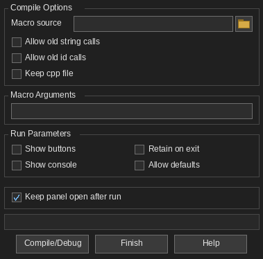
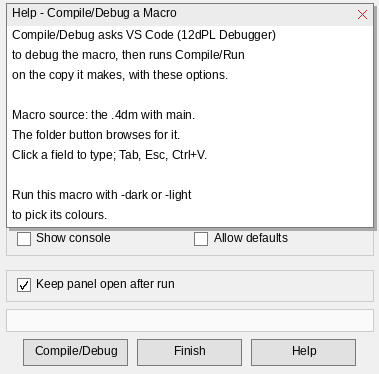

# Compile/Debug a Macro, drawn in a Draw_Box (experiment)

A proof of concept: the companion panel (`../compile_debug_macro_panel.4dm`)
rebuilt with its widgets drawn in one `Draw_Box`, so it can have a light and a
dark theme. It does the same work: the original file is included unchanged and
its `request_debug_build()`, `panel_prompt_compile_run_a_macro()` and
`about_panel()` are called as they are. The extension still ships and builds
the original panel; this one is built by hand.

| Light (default) | Dark (`-dark`) |
| --- | --- |
|  |  |
|  |  |

The screenshots come from the Linux preview in `tools/draw_panel_preview`, not from
12d. It uses a different font, so text widths differ a little from 12d's.

## Building and running

Compile `compile_debug_draw_panel.4dm` with `cc4d.exe` from this folder (as
**12dPL: Build Companion Macro** does for the original). It includes files by
relative path, which works when `cc4d.exe` is run directly. 12d's own Compile
option looks for includes in the project folder, so it won't find them.

The theme comes from the macro's command line (Macro Arguments in 12d's
Run/Compile panels):

| Argument | Theme |
| --- | --- |
| none, `-light`, `/light`, `light`, `--theme=light` | light |
| `-dark`, `/dark`, `dark`, `--theme=dark` | dark |

The last argument that names a theme wins. Other arguments are ignored.

## Layout

```
compile_debug_draw_panel.4dm   base file: main() reads the theme and shows the panel
src/build.4dm                  includes the original panel (main renamed), then the files below
src/draw_ui.4dm                the kit: widget record, popup list, mouse and keys -> actions
src/draw_ui_render.4dm         the kit: drawing the widgets and the popup
src/draw_ui_theme.4dm          the kit: light and dark colours, command line
src/draw_ui_files.4dm          the kit: a file browser in the popup
src/debug_draw_panel.4dm       this panel: layout, and what its buttons do
include/*.h                    #defines and prototypes for each
```

Only `debug_draw_panel.4dm` knows about this panel. The `dui_*` files are a
small widget kit that any macro can use.

## The Draw UI kit

It follows the pattern from Cubeland's menus (`12dpl-minecraft-macro`,
`src/render/render_menu.4dm`). A screen is an `Attributes` record. Each frame
the widgets are laid out again and drawn. Values (a field's text, a tick) are
kept under the widget's id, so they survive from frame to frame:

```
// each frame
Start_batch_draw(box);
dui_begin(ui, w, h);
dui_add_down(ui, DUI_TICK, MY_TICK, x0, top, x1, bottom, "Label", TRUE);  // distances from the top
...
dui_draw(box, ui, theme);
End_batch_draw(box);

// each event
if (id == Get_id64(box))  act = dui_mouse(ui, cmd, msg, widget);
if (id == Get_id64(keys)) act = dui_keystroke(ui, msg, widget);
switch (act) {   // DUI_ACT_REDRAW / CLICK / TICK / PICK / ENTER, with the widget's id
  ...
}
```

| Kind | What it does |
| --- | --- |
| `DUI_GROUP` | A frame with its title on the top line, like a 12d group border. An empty title draws a plain frame. |
| `DUI_LABEL` | A line of text. |
| `DUI_TICK` | A tick box. A click ticks it (`DUI_ACT_TICK`). |
| `DUI_FIELD` | A one-line text box. A click gives it the keyboard. It takes typing, Backspace, Ctrl+Backspace, Ctrl+C/X/V (clipboard), Esc and Enter. |
| `DUI_BUTTON` | A push button (`DUI_ACT_CLICK`). An `&` in the label is dropped, as in 12d. |
| `DUI_BROWSE` | The folder button at the end of a file field. |
| `DUI_MESSAGE` | The message line. `dui_set_message(..., TRUE)` shows the text in red. |
| popup | One list over the widgets, like a choice box's list. It has a title bar, a close cross, row icons and a scroll bar (click the track to page, or drag it). A row with a value can be picked (`DUI_ACT_PICK`). A row with no value is plain text, which the help uses. |

`dui_files_open()` / `dui_files_pick()` fill the popup with a folder's sub folders and
matching files. A Draw_Box panel can't open 12d's own file dialog, so this
stands in for the File_Box's browse button.

Themes are records of colours by role (`DUI_C_TEXT`, `DUI_C_ACCENT`, ...).
To add a theme, add a case to `dui_theme_set()`.

## What was learnt about the Draw_Box (from Cubeland)

- Draw only between `Start_batch_draw` and `End_batch_draw`, and redraw the
  whole box each time (`Clear` first).
- y goes up from the bottom left. Text is placed by its top (`Set_text_align`
  0 for top left, 6 for top centre, which are Windows' `TA_*` flags).
  `Set_bk_mode(box, 1)` draws text with no background box.
- A filled rectangle is a 4 point `Draw_polygon` with `Set_colour` and
  `Set_fill_colour` set to the same colour. Each call costs about as much as
  a polygon, so the kit doesn't set a colour that is already set.
- 12d can't measure text, so widths are estimates (`DUI_CHAR_WIDTH`). Long
  text is cut short with `...`. Fields and paths keep their end in view.
- A Draw_Box gets mouse events (`mouse_move`, `click_lb_down`, `click_lb`,
  `double_click_lb`, `mouse_leave`, with `"x y"` in the message) but no key
  presses. A small input box ("Keys") under the drawing keeps the keyboard.
  Its `keystroke` events are passed to the focused field, and it is emptied
  after each one.
- `Set_sizing_constraints(box, 2, 2)` and `Set_notify_resizing(panel)` let the
  drawing fill a resized panel (`Panel_Resize`).

## Not checked in 12d yet

This was written and run on Linux only, in the preview. Things to check in 12d:

- `#define main ...` before including the original file, so its `main` gets
  another name.
- Whether 12d sends Tab, Ctrl+C/X/V and Enter to the Keys box as `keystroke`
  events (Enter may come as `text selected`; both are handled), or uses them
  itself.
- `List_subfolders_in_folder` / `List_files_in_folder`: whether they return
  names or full paths (both are handled).
- Text placement with Segoe UI, and the `DUI_CHAR_WIDTH` estimate.
- `request_debug_build()` writes its progress into a message box that isn't on
  the panel. The drawn line shows "Starting the debugger in VS Code..." before
  it is called, and its last message after it returns. The "Waiting for VS
  Code to start..." step in between isn't shown.
